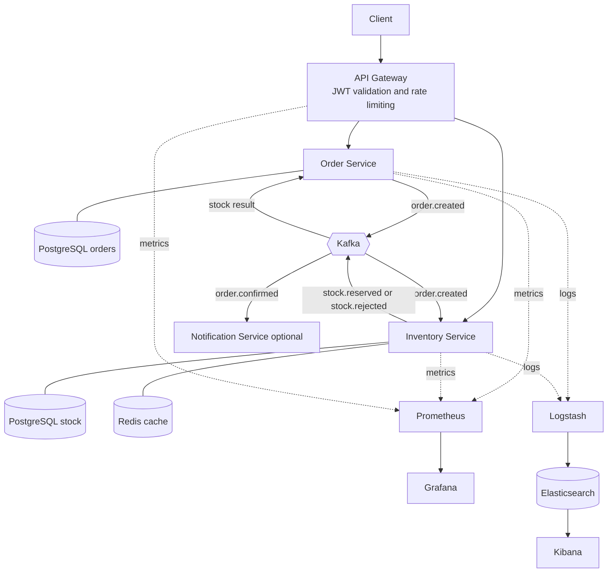

# PLAN.md: Order and Inventory Platform

> Instructions for the OpenCode coding agent. Build this project from an empty repository to a finished, deployable system. Follow the phases in order. Do not start a phase until the previous phase's **Check** passes. After each task, commit with a conventional message (`feat:`, `fix:`, `chore:`, `docs:`, `test:`).

---

## 0. Agent operating rules

1. **Work autonomously, in small steps.** After every task: build, run tests, commit.
2. **Never commit secrets.** Use `.env` (git-ignored) and keep `.env.example` current.
3. **One database per service.** Services never read each other's tables. They communicate only via REST (through the gateway) and Kafka events.
4. **All event publishing from the order service goes through the outbox table.** Never call `KafkaTemplate.send` directly from a business transaction.
5. **All Kafka consumers must be idempotent** (check `processed_events` by `eventId` before acting).
6. **Do not overbuild.** Use the smallest AWS sizes. Document `terraform destroy`.
7. **Write tests with the code**, not at the end.
8. **If blocked** (missing tool, ambiguous requirement, failing check): log the issue in `docs/BLOCKERS.md`, choose the simplest reasonable option, and continue. Record decisions as ADRs in `docs/adr/`.
9. **Keep a progress log** at `docs/PROGRESS.md`. Tick the phase checklist items as they complete.
10. **Verify before claiming done.** Run the actual commands in each Check and report real output.

---

## 1. Goal

Build a microservice system where placing an order reliably reserves stock, survives failures (broker down, duplicate events, service restarts), and can be built, deployed, and monitored like a production system.

## 2. Tech stack (fixed, do not substitute)

| Concern | Choice |
|---|---|
| Language / framework | Java 21, Spring Boot 3.x, Maven (multi-module or per-service poms) |
| Gateway | Spring Cloud Gateway |
| Databases | PostgreSQL 16 (one per service) |
| Migrations | Flyway |
| Cache | Redis 7 |
| Messaging | Apache Kafka (KRaft mode in Compose) |
| Auth | JWT (HS256 for dev, configurable secret), roles `CUSTOMER`, `ADMIN` |
| API docs | springdoc-openapi |
| Testing | JUnit 5, Mockito, Testcontainers, REST Assured or MockMvc, k6 |
| Observability | Spring Boot Actuator, Micrometer, Prometheus, Grafana, Logstash, Elasticsearch, Kibana |
| Containers | Docker (multi-stage, non-root), Docker Compose |
| Orchestration | Kubernetes manifests (Helm chart optional) |
| IaC | Terraform on AWS (remote state in S3 + DynamoDB lock) |
| CI/CD | Jenkins (`Jenkinsfile`) |
| Static analysis | Checkstyle or SpotBugs, OWASP dependency-check |

Base package: `com.example.orderplatform` (service-specific subpackages: `gateway`, `order`, `inventory`, `notification`).

## 3. Architecture



### Services

| Service | Responsibility | Data |
|---|---|---|
| api-gateway | Routing, JWT authentication, rate limiting | none |
| order-service | Create/track orders, saga coordination | `orders`, `order_items`, `outbox_events`, `processed_events` |
| inventory-service | Products, stock, reservations | `products`, `stock`, `reservations`, `processed_events` |
| notification-service (optional) | Log/send confirmation messages | none |

### Order flow (choreography saga)

1. `POST /orders` → order service saves order `PENDING` and writes `order.created` to `outbox_events` in the same transaction.
2. Outbox publisher sends `order.created` to Kafka.
3. Inventory service consumes it and reserves stock in a DB transaction (row lock).
4. Success → publishes `stock.reserved`. Failure → publishes `stock.rejected`.
5. Order service consumes the result → `CONFIRMED` or `CANCELLED`. On `CONFIRMED`, publish `order.confirmed` (via outbox).
6. `POST /orders/{id}/cancel` → order set to `CANCELLED`, publish `order.cancelled` (via outbox); inventory releases the reservation.

### Kafka topics

| Topic | Producer | Consumer | Key |
|---|---|---|---|
| `order.created` | order-service | inventory-service | orderId |
| `stock.reserved` | inventory-service | order-service | orderId |
| `stock.rejected` | inventory-service | order-service | orderId |
| `order.confirmed` | order-service | notification-service | orderId |
| `order.cancelled` | order-service | inventory-service | orderId |
| `*.DLT` | Spring dead-letter recoverer | none (inspect manually) | same |

Create topics with 3 partitions each (via `NewTopic` beans or an init container in Compose).

### Event envelope (JSON)

```json
{
  "eventId": "uuid",
  "type": "order.created",
  "occurredAt": "2026-01-15T10:30:00Z",
  "correlationId": "uuid",
  "orderId": "uuid",
  "items": [ { "productId": 101, "quantity": 2 } ]
}
```

`correlationId` is generated at the gateway (header `X-Correlation-Id`), copied into every event and into the log MDC.

## 4. Repository layout (create exactly this)

```
order-platform/
├── services/
│   ├── api-gateway/
│   ├── order-service/
│   ├── inventory-service/
│   └── notification-service/
├── deploy/
│   ├── docker-compose.yml
│   ├── k8s/
│   └── terraform/
├── observability/        # prometheus.yml, alert rules, grafana dashboards, logstash pipeline
├── load-tests/           # k6 scripts
├── docs/                 # diagrams, adr/, PROGRESS.md, BLOCKERS.md
├── Jenkinsfile
├── Makefile
├── .env.example
├── .gitignore
├── LICENSE
└── README.md
```

## 5. Data model

**inventory-service**
- `products(id BIGSERIAL PK, sku UNIQUE, name, description, price NUMERIC(12,2), created_at)`
- `stock(product_id PK/FK, available INT CHECK >= 0, version BIGINT)`
- `reservations(id UUID PK, order_id UUID UNIQUE-per-product, product_id, quantity, status [RESERVED|RELEASED], created_at)`
- `processed_events(event_id UUID PK, processed_at)`

**order-service**
- `orders(id UUID PK, user_id, status [PENDING|CONFIRMED|CANCELLED], idempotency_key UNIQUE per user, total NUMERIC, created_at, updated_at, version)`
- `order_items(id, order_id FK, product_id, quantity, unit_price)`
- `outbox_events(id UUID PK, aggregate_id, topic, payload JSONB, status [NEW|SENT], created_at, sent_at)`
- `processed_events(event_id UUID PK, processed_at)`

All schema changes via Flyway files `V1__...sql`, `V2__...sql` per service.

## 6. API contract

**Inventory service** (reached through gateway at `/api/inventory/...`)

| Method | Path | Notes |
|---|---|---|
| POST | `/products` | ADMIN. Creates product and initial stock. |
| GET | `/products` | Paginated (`page`, `size`), cached in Redis |
| GET | `/products/{id}` | Cached |
| PUT | `/products/{id}/stock` | ADMIN. Updates stock, evicts cache |

**Order service** (reached through gateway at `/api/orders/...`)

| Method | Path | Notes |
|---|---|---|
| POST | `/orders` | Requires `Idempotency-Key` header. Same key + same user returns the original order, no duplicate. |
| GET | `/orders/{id}` | Owner or ADMIN |
| GET | `/orders` | Current user's orders, paginated |
| POST | `/orders/{id}/cancel` | Releases reserved stock |

Also: `POST /auth/login` on the gateway (or a tiny auth module) issuing JWTs for seeded demo users (`customer1`/`admin1`; passwords from env). Errors use RFC 7807 problem-details format via a global exception handler.

---

## 7. Phases

Track each item as done in `docs/PROGRESS.md`.

### Phase 0: Bootstrap
- [ ] `git init`, `.gitignore` (Java, IDE, `.env`, `target/`), `LICENSE` (MIT), root `README.md` stub, `.env.example`, `Makefile` (`up`, `down`, `test`, `build`, `logs`).
- [ ] Create the folder layout from section 4.
- [ ] `deploy/docker-compose.yml` with PostgreSQL (two databases: `orders`, `stock`, via init script or two containers), Redis, Kafka (KRaft). Health checks on all.
- [ ] Verify Java 21 and Maven work. Create the four Spring Boot modules (Initializr-equivalent poms: web, validation, data-jpa, actuator, flyway, postgresql, kafka, data-redis where relevant, security, springdoc, micrometer-registry-prometheus, lombok optional, testcontainers).

**Check:** `docker compose up -d` shows all infra containers healthy; each service module compiles with `mvn -q verify -DskipTests`.

### Phase 1 (Week 1): Inventory service foundation
- [ ] Flyway `V1` migrations for `products`, `stock`, `reservations`, `processed_events`.
- [ ] Entities, repositories, service layer, controller, DTOs with Bean Validation, mapper.
- [ ] Global exception handler (problem-details); 404, 400, 409 handled.
- [ ] springdoc OpenAPI at `/swagger-ui.html`.
- [ ] Unit tests for the service layer (JUnit 5 + Mockito).
- [ ] Dockerfile placeholder not required yet; run via Maven locally.

**Check:** run the service, create products and read them back through Swagger UI. Unit tests pass.

### Phase 2 (Week 2): Orders and events
- [ ] Order service: entities, status lifecycle (`PENDING`, `CONFIRMED`, `CANCELLED`), `POST /orders` with `Idempotency-Key`, `GET` endpoints, cancel endpoint.
- [ ] Kafka config in both services: JSON serializers, typed event classes, topic beans.
- [ ] Inventory consumer for `order.created`: in one transaction, check `processed_events`, lock stock rows (`SELECT ... FOR UPDATE` or `@Version` with retry), decrement stock for all items or none, insert reservations, record `eventId`, then publish `stock.reserved` or `stock.rejected`.
- [ ] Order consumer for `stock.reserved` / `stock.rejected`: idempotent status update.
- [ ] Inventory consumer for `order.cancelled`: release reservations, restore stock, idempotent.
- [ ] Error handling: retry with backoff (e.g. 3 attempts), then dead-letter topic `<topic>.DLT`.
- [ ] Tests: reservation success, insufficient stock, multi-item all-or-nothing, replaying the same event does not reserve twice, concurrent reservations never oversell (run N threads against stock of M).

**Check:** placing an order ends `CONFIRMED` or `CANCELLED` correctly; replaying the same `order.created` event twice leaves stock decremented once.

### Phase 3 (Week 3): Reliability and security
- [ ] **Transactional outbox** in order service: write `outbox_events` row in the same transaction as the order change. Background publisher (`@Scheduled`, batch, `SELECT ... FOR UPDATE SKIP LOCKED`) sends to Kafka, marks `SENT` after broker ack. Apply the same outbox approach in inventory service for `stock.*` events.
- [ ] API gateway: routes to both services, JWT validation filter, role checks (admin-only routes), generates/propagates `X-Correlation-Id`, Redis-backed rate limiter (`RequestRateLimiter`).
- [ ] Services trust gateway-forwarded identity (validated JWT claims or re-validate JWT; document the choice in an ADR).
- [ ] Redis caching in inventory: `@Cacheable` for product reads (TTL 5 min), evict on stock/product update. Expose cache hit/miss metrics.
- [ ] Integration tests with Testcontainers (PostgreSQL, Kafka, Redis): full saga happy path, rejection path, idempotent order creation, security (401/403), cache eviction.
- [ ] Failure test (script or test): stop Kafka mid-flow, create order, restart Kafka, order still completes.

**Check:** the kill-Kafka-and-restart scenario ends with the order confirmed and no duplicate reservation. All integration tests pass.

### Phase 4 (Week 4): Containers and CI/CD
- [ ] Multi-stage Dockerfile per service: build on `maven:3-eclipse-temurin-21`, run on `eclipse-temurin:21-jre` (or distroless), non-root user, `HEALTHCHECK`, layered jar.
- [ ] Add all services to `docker-compose.yml` (profiles: `core`, `observability`). `docker compose up` starts the whole system with one command.
- [ ] `Jenkinsfile` (declarative) stages: Checkout, Build, Unit Tests, Integration Tests, Static Analysis, Dependency Scan, Build Images, Push Images, Deploy. Publish JUnit reports and coverage (JaCoCo).
- [ ] Add Checkstyle or SpotBugs and OWASP dependency-check to the Maven build; fix or document findings.

**Check:** `make up` starts everything locally; `Jenkinsfile` lints/validates and the pipeline logic passes locally where runnable (`mvn verify`). Document in README how to connect a Jenkins instance.

### Phase 5 (Week 5): Kubernetes, Terraform, AWS
- [ ] `deploy/k8s/`: Namespace, Deployments, Services, ConfigMaps, Secrets (templates only, no real values), readiness/liveness probes (Actuator), resource requests and limits, HorizontalPodAutoscaler for order and inventory, Ingress for the gateway. Validate with `kubectl apply --dry-run=client` and `kubeconform` if available. Verify on kind/minikube if tooling exists.
- [ ] `deploy/terraform/`: modules or files for VPC, subnets, security groups, ECR repositories, RDS PostgreSQL (smallest class, single-AZ), and the compute layer (small EKS or ECS Fargate; pick the cheaper/simpler and record an ADR). S3 + DynamoDB remote state. Variables, outputs, `terraform.tfvars.example`. Run `terraform fmt` and `terraform validate`.
- [ ] Document `terraform apply` and **`terraform destroy`** clearly in `deploy/terraform/README.md`, including a cost warning.
- [ ] Do not run `terraform apply` against a real AWS account unless credentials are explicitly provided by the user.

**Check:** `terraform validate` passes; k8s manifests pass dry-run validation; docs describe the full apply/deploy/destroy flow.

### Phase 6 (Week 6): Observability and proof
- [ ] Metrics: Actuator + Micrometer in all services; custom metrics (orders created/confirmed/cancelled, reservation failures, outbox backlog, cache hits/misses). `observability/prometheus.yml` scrapes all services. Kafka consumer lag exposed (Micrometer Kafka metrics or an exporter).
- [ ] Grafana dashboard JSON (provisioned): request rate, error rate, p95 latency, JVM memory, Kafka consumer lag, cache hit ratio.
- [ ] Prometheus alert rule: error rate > 5% for 5 minutes.
- [ ] Structured JSON logging (Logback + logstash encoder), correlation ID in MDC across HTTP and Kafka (use consumer/producer interceptors or record headers). Logstash pipeline → Elasticsearch; Kibana saved search/view filtered by `correlationId`.
- [ ] k6 scripts in `load-tests/`: `GET /products` (with and without cache via a toggle property), `POST /orders` ramp test, and a script run while a service is stopped. Save raw results under `load-tests/results/`.
- [ ] Run the load tests locally and record real numbers.
- [ ] Final docs: README (template in section 9), architecture diagram, ADRs, demo script.

**Check:** dashboards load with data, one order can be traced across services by `correlationId`, k6 results recorded.

---

## 8. Testing strategy

| Level | Tool | Cover |
|---|---|---|
| Unit | JUnit 5, Mockito | Business rules, reservation logic |
| Integration | Testcontainers | Postgres, Kafka, Redis behaviour |
| API/contract | REST Assured or MockMvc | Status codes, validation, security |
| Load | k6 | Throughput, latency, failure under load |
| Failure | Scripts | Broker down, duplicate events, service restart |

Prioritize the reservation and saga logic; do not chase a vanity coverage number. Enable JaCoCo reports.

## 9. README requirements (write at the end, using real results)

1. One-line description and problem it solves
2. Architecture diagram (Mermaid)
3. Tech stack table
4. Quick start: `git clone`, `cp .env.example .env`, `docker compose up`
5. API examples (curl with sample responses)
6. Testing instructions and coverage badge
7. Results: p95 and RPS for `GET /products` with and without Redis, orders/second before errors, dashboard and Kibana screenshots (placeholders if screenshots cannot be captured), failure-recovery observations
8. Design decisions: why each major technology, what would change at scale
9. Roadmap and known limitations (be honest)

Also write ADRs for: events vs HTTP, outbox pattern, locking strategy, JWT approach, ECS vs EKS choice, and idempotency design.

## 10. Common pitfalls (avoid)

- Sharing one database between services.
- Publishing events outside the DB transaction.
- Non-idempotent consumers.
- Overbuilding AWS.
- Leaving tests until the end.

## 11. Definition of done

- [ ] Runs with one command locally (`make up`)
- [ ] Automated tests pass on every push (Jenkins pipeline defined and validated)
- [ ] Deployable: Kubernetes manifests and Terraform validated and documented
- [ ] README complete with diagram and real measured numbers
- [ ] Demo script (`docs/DEMO.md`) with the exact commands for a 2 to 3 minute walkthrough
- [ ] Every design choice recorded in an ADR

## 12. Final report

When all phases are complete, append to `docs/PROGRESS.md`: what was built, what was verified (with command output), what could not be verified and why (for example no AWS credentials), and suggested next steps (OpenTelemetry tracing, circuit breakers).
