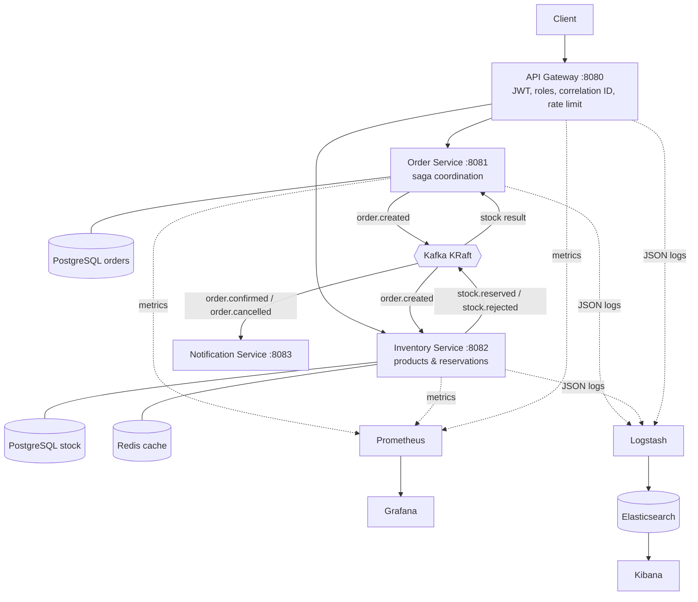

# Order and Inventory Platform

A Java 21 / Spring Boot microservice system where placing an order reliably reserves stock, survives a Kafka outage, and never double-reserves — built, deployed and monitored like a production system.

> **Build status:** the complete source tree is implemented. The local build environment does not have Java, Maven, Docker, kubectl, Terraform or k6 installed (see [`docs/BLOCKERS.md`](docs/BLOCKERS.md)), so runtime checks and load-test numbers are **not verified**. All source-level files are present and internally consistent.

## Architecture



### Order flow (choreography saga)

1. `POST /api/orders` → order is saved `PENDING` and `order.created` is written to `outbox_events` **in the same transaction**.
2. The outbox publisher sends `order.created` to Kafka.
3. Inventory checks `processed_events`, locks stock rows (`FOR UPDATE`, sorted IDs) and reserves **all** items or none.
4. Inventory writes `stock.reserved` / `stock.rejected` to **its** outbox, which is published to Kafka.
5. Order-service consumes the result: `CONFIRMED` or `CANCELLED`. On confirm it writes `order.confirmed` to its outbox.
6. `POST /api/orders/{id}/cancel` writes `order.cancelled`; inventory releases the reservation and restores stock.

Every event carries a `correlationId` generated at the gateway, copied into all events and into the log MDC.

## Tech stack

| Concern | Choice |
|---|---|
| Language / framework | Java 21, Spring Boot 3.3.5, Maven multi-module |
| Gateway | Spring Cloud Gateway 2023.0.3 (WebFlux) |
| Databases | PostgreSQL 16, one per service |
| Migrations | Flyway (`V1`, `V2` per service) |
| Cache / rate limit | Redis 7 |
| Messaging | Apache Kafka 3.7 (KRaft), 3 partitions per topic + `.DLT` |
| Auth | HS256 JWT, roles `CUSTOMER` / `ADMIN` |
| API docs | springdoc-openapi |
| Testing | JUnit 5, Mockito, Testcontainers, MockMvc/WebTestClient, k6 |
| Observability | Actuator, Micrometer, Prometheus, Grafana, Logstash, Elasticsearch, Kibana |
| Containers | Multi-stage non-root Docker images, Docker Compose profiles |
| Orchestration | Kubernetes manifests + kustomization |
| IaC | Terraform → AWS ECS Fargate, RDS, ECR, S3+DynamoDB state |
| CI/CD | Jenkins declarative pipeline |
| Static analysis | SpotBugs, OWASP dependency-check (in the Maven/Jenkins build) |

## Quick start

Requires JDK 21+, Maven 3.9+, Docker with Compose v2.

```bash
git clone <your-repo-url> order-platform
cd order-platform
cp .env.example .env
make up          # core + observability; ~2-3 min on first run
```

Useful endpoints:

| URL | Purpose |
|---|---|
| `http://localhost:8080/swagger-ui.html` | Gateway API docs |
| `http://localhost:8081/swagger-ui.html` | Order service docs |
| `http://localhost:8082/swagger-ui.html` | Inventory service docs |
| `http://localhost:9090` | Prometheus |
| `http://localhost:3000` | Grafana (`admin` / value of `GRAFANA_ADMIN_PASSWORD`) |
| `http://localhost:5601` | Kibana |

Stop with `make down` (`make clean` also deletes volumes).

## API examples

All client calls go through the gateway on port 8080.

### 1. Log in

```bash
curl -s -X POST http://localhost:8080/auth/login \
  -H 'Content-Type: application/json' \
  -d '{"username":"admin1","password":"admin123"}'
```

```json
{"accessToken":"eyJhbGciOiJIUzI1NiJ9...","tokenType":"Bearer","expiresIn":3600}
```

### 2. Create a product (ADMIN)

```bash
TOKEN=$(curl -s -X POST http://localhost:8080/auth/login \
  -H 'Content-Type: application/json' \
  -d '{"username":"admin1","password":"admin123"}' | jq -r .accessToken)

curl -s -X POST http://localhost:8080/api/inventory/products \
  -H "Authorization: Bearer $TOKEN" \
  -H 'Content-Type: application/json' \
  -d '{"sku":"WIDGET-1","name":"Widget","description":"A useful widget","price":9.99,"initialStock":100}'
```

```json
{"id":1,"sku":"WIDGET-1","name":"Widget","description":"A useful widget","price":9.99,"available":100,"createdAt":"2026-11-23T10:30:00Z"}
```

### 3. Place an order (CUSTOMER)

```bash
CTOKEN=$(curl -s -X POST http://localhost:8080/auth/login \
  -H 'Content-Type: application/json' \
  -d '{"username":"customer1","password":"customer123"}' | jq -r .accessToken)

curl -s -X POST http://localhost:8080/api/orders \
  -H "Authorization: Bearer $CTOKEN" \
  -H 'Content-Type: application/json' \
  -H "Idempotency-Key: $(uuidgen)" \
  -d '{"items":[{"productId":1,"quantity":2,"unitPrice":9.99}]}'
```

```json
{"id":"9e4f...","userId":"customer1","status":"PENDING","total":19.98,
 "items":[{"productId":1,"quantity":2,"unitPrice":9.99}],
 "createdAt":"2026-11-23T10:31:00Z","updatedAt":"2026-11-23T10:31:00Z"}
```

Poll until the saga completes:

```bash
curl -s http://localhost:8080/api/orders/9e4f... -H "Authorization: Bearer $CTOKEN"
# → "status":"CONFIRMED"   (or "CANCELLED" if stock was insufficient)
```

Errors use RFC 7807 problem details, e.g. 404:

```json
{"type":"about:blank","title":"Resource not found","status":404,"detail":"Order ... not found"}
```

See [`docs/DEMO.md`](docs/DEMO.md) for a 2–3 minute scripted walkthrough.

## Testing

```bash
mvn test       # unit tests: no Docker required
mvn verify     # unit + Testcontainers integration tests (Docker required)
make test      # wrapper for mvn test
```

Coverage is produced by JaCoCo at `target/site/jacoco/index.html` per module.

 *(placeholder — no real badge until CI publishes one)*

Test layers:

| Level | Tool | What it covers |
|---|---|---|
| Unit | JUnit 5 + Mockito | reservation rules, all-or-nothing, saga transitions, idempotency |
| Integration | Testcontainers | PostgreSQL, Kafka, Redis; concurrent oversell, happy/rejection paths, outbox publish |
| API | MockMvc / WebTestClient | status codes, validation, problem details, correlation header |
| Load | k6 | product reads with/without cache, order ramp, failure probe |
| Failure | scripts + k6 | broker down, duplicate events, service restart |

## Results

> **NOT MEASURED in this environment** (Docker/k6 unavailable — B-002/B-006). The commands below produce the real numbers on a machine with the toolchain. Placeholders are intentional; no invented metrics are reported.

| Metric | Cached | Without Redis | Where to read it |
|---|---|---|---|
| `GET /products` p95 | *pending* | *pending* | `load-tests/results/products-*-summary.json` |
| `GET /products` RPS | *pending* | *pending* | same |
| Orders/second before errors | *pending* | — | `load-tests/results/orders-summary.json` |
| Dashboard screenshot | *pending* | — | `docs/screenshots/grafana.png` |
| Kibana correlation search | *pending* | — | `docs/screenshots/kibana.png` |
| Kill-Kafka recovery | *pending* | — | `docs/DEMO.md` step 7 |

Run them with:

```bash
k6 run -e CACHE_ENABLED=true  --summary-export=load-tests/results/products-cached-summary.json   load-tests/products.js
k6 run -e CACHE_ENABLED=false --summary-export=load-tests/results/products-uncached-summary.json load-tests/products.js
k6 run -e RUN_ID=run-001      --summary-export=load-tests/results/orders-summary.json            load-tests/orders.js
```

## Design decisions

All choices are recorded as ADRs in [`docs/adr/`](docs/adr/):

- [ADR-001](docs/adr/ADR-001-events-vs-http.md) — events vs HTTP for the saga
- [ADR-002](docs/adr/ADR-002-transactional-outbox.md) — transactional outbox
- [ADR-003](docs/adr/ADR-003-locking-strategy.md) — pessimistic row locking
- [ADR-004](docs/adr/ADR-004-jwt-approach.md) — JWT approach
- [ADR-005](docs/adr/ADR-005-ecs-vs-eks.md) — ECS vs EKS
- [ADR-006](docs/adr/ADR-006-idempotency-design.md) — idempotency design
- [ADR-007](docs/adr/ADR-007-database-per-service.md) — database per service
- [ADR-008](docs/adr/ADR-008-jwt-revalidation-at-services.md) — JWT re-validation at services
- [ADR-009](docs/adr/ADR-009-notification-dedupe.md) — notification dedupe

Deployment details: [Docker Compose](deploy/README.md), [Kubernetes](deploy/k8s/README.md), [Terraform](deploy/terraform/README.md), [observability](observability/README.md), [load tests](load-tests/README.md).

## Roadmap and known limitations

- **Build not verified locally** — no JDK/Maven/Docker in this environment (B-001…B-006).
- **Client-supplied unit prices** — `POST /orders` trusts `unitPrice` from the request to avoid a synchronous price lookup; a real system must price from the catalog.
- **No API for outbox inspection** — use SQL or Grafana for now.
- **`processed_events` retention** — add a cleanup job before high-volume production.
- **HS256 shared secret** — replace with an IdP + RS256/JWKS.
- **Raw Logstash HTTP input on 5045** — no authentication; restrict to the Docker network.
- **No distributed tracing** — correlation IDs only; OpenTelemetry is the next step.
- **Notification service logs only** — no real email/SMS.
- **Kubernetes and Terraform are unapplied** — no cluster or AWS credentials were provided.

Suggested next steps: OpenTelemetry tracing, circuit breakers around downstream calls, a real authorization server, Kafka lag exporter in the AWS deployment, and retention policies for `outbox_events` / `processed_events`.
