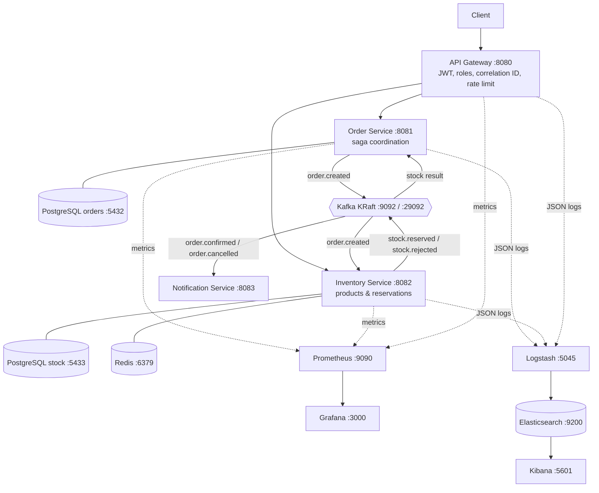

# Order and Inventory Platform

A Java 21 / Spring Boot microservice system where placing an order reliably reserves stock, survives a Kafka outage, and never double-reserves — built, deployed and monitored like a production system.

Clients talk only to an API gateway. The gateway authenticates them, stamps every request with a correlation ID, and routes to the order and inventory services. Those services coordinate a multi-step business transaction through Kafka events rather than synchronous calls, using a transactional outbox and idempotent consumers so that no failure leaves the system half-updated.

> **Build status:** the complete source tree is implemented. The local build environment does not have Java, Maven, Docker, kubectl, Terraform or k6 installed (see [`docs/BLOCKERS.md`](docs/BLOCKERS.md)), so runtime checks and load-test numbers are **not verified**. All source-level files are present and internally consistent. No fabricated metrics or screenshots are included.

---

## Table of contents

1. [What this app does](#1-what-this-app-does)
2. [Architecture](#2-architecture)
3. [Tech stack](#3-tech-stack)
4. [Repository layout](#4-repository-layout)
5. [Configuration](#5-configuration)
6. [Quick start](#6-quick-start)
7. [Authentication and authorization](#7-authentication-and-authorization)
8. [API reference](#8-api-reference)
9. [Data model](#9-data-model)
10. [Reliability mechanisms](#10-reliability-mechanisms)
11. [Testing](#11-testing)
12. [Observability](#12-observability)
13. [Load testing](#13-load-testing)
14. [Deployment](#14-deployment)
15. [Design decisions](#15-design-decisions)
16. [Demo walkthrough](#16-demo-walkthrough)
17. [Troubleshooting](#17-troubleshooting)
18. [Roadmap and known limitations](#18-roadmap-and-known-limitations)
19. [Verification status](#19-verification-status)

---

## 1. What this app does

### The problem

Placing an order across two services is deceptively hard. If order-service commits an order and then calls inventory-service over HTTP, a crash between the two leaves an order with no stock reservation — or a reservation with no order. Retries can reserve stock twice. If the message broker is down, naive implementations lose the event entirely.

### Guarantees this platform provides

| Guarantee | Mechanism |
|---|---|
| An order and its `order.created` event are never out of sync | Transactional outbox — both written in one local DB transaction |
| No overselling, even with 10 concurrent buyers | `SELECT … FOR UPDATE` on stock rows, sorted product IDs, all-or-nothing validation |
| Duplicate HTTP requests don't create duplicate orders | `Idempotency-Key` header + unique `(user_id, idempotency_key)` constraint |
| Duplicate Kafka deliveries don't reserve/confirm twice | `processed_events(event_id)` checked in the same transaction as the state change |
| Kafka outages don't lose orders | Events stay `NEW` in the outbox and are published when the broker returns |
| Poison messages don't block a consumer | 3 exponential retries, then the topic's `.DLT` |
| Every request is traceable end-to-end | `X-Correlation-Id` propagated through HTTP, Kafka and log MDC |

### What it explicitly does *not* do

- It does not take payment or send real email/SMS (the notification service only logs).
- It does not price orders from the catalog — the client supplies `unitPrice` (see [limitations](#18-roadmap-and-known-limitations)).
- It does not expose a UI beyond Swagger UI and the observability dashboards.

---

## 2. Architecture

### 2.1 Component diagram



### 2.2 Services at a glance

| Service | Port | Responsibility | Datastore | Framework |
|---|---|---|---|---|
| `api-gateway` | 8080 | Login (JWT issuance), token validation, route authorization, correlation IDs, Redis rate limiting, aggregated OpenAPI | Redis (rate limit) | Spring Cloud Gateway (WebFlux) |
| `order-service` | 8081 | Order API, saga state machine, idempotency, transactional outbox | PostgreSQL `orders` | Spring MVC |
| `inventory-service` | 8082 | Product catalogue, cached reads, stock reservations and releases, transactional outbox | PostgreSQL `stock` + Redis | Spring MVC |
| `notification-service` | 8083 | Optional logger of `order.confirmed` / `order.cancelled` | none | Spring Boot consumer |

Supporting infrastructure: 2× PostgreSQL 16, Redis 7, Kafka 3.7 in KRaft mode, and (opt-in) Prometheus, Grafana, Logstash, Elasticsearch, Kibana.

### 2.3 Order flow (choreography saga)

```mermaid
sequenceDiagram
    participant Client
    participant GW as API Gateway
    participant OS as Order Service
    participant K as Kafka
    participant IS as Inventory Service
    participant NS as Notification Service

    Client->>GW: POST /api/orders (Idempotency-Key)
    GW->>OS: POST /orders + JWT + X-Correlation-Id
    OS->>OS: BEGIN: save order PENDING + outbox(order.created); COMMIT
    OS->>K: publish order.created
    K->>IS: order.created
    IS->>IS: dedupe + lock stock rows + reserve all items + outbox(stock.*)
    IS->>K: publish stock.reserved / stock.rejected
    K->>OS: stock result
    OS->>OS: dedupe + CONFIRMED or CANCELLED (+ outbox on confirm)
    OS->>K: publish order.confirmed / order.cancelled
    K->>NS: log order event
    Client->>GW: GET /api/orders/{id} (poll)
    GW->>OS: GET /orders/{id}
    OS-->>Client: CONFIRMED / CANCELLED
```

Step by step:

1. `POST /api/orders` → order is saved `PENDING`, and `order.created` is written to `outbox_events` **in the same transaction**.
2. The scheduled publisher (`FOR UPDATE SKIP LOCKED`, batch 50, 500 ms poll) sends `order.created` to Kafka and marks the row `SENT` only after the broker ack.
3. Inventory checks `processed_events`, locks stock rows (`FOR UPDATE`, product IDs sorted to avoid deadlocks), validates **all** items, then decrements and writes reservations — all in one transaction.
4. Inventory writes `stock.reserved` or `stock.rejected` to **its** outbox, which its own publisher sends.
5. Order-service consumes the result and sets the order to `CONFIRMED` or `CANCELLED`; confirming writes `order.confirmed` to its outbox.
6. `POST /api/orders/{id}/cancel` writes `order.cancelled`; inventory consumes it, releases the reservation and restores stock.

Every event carries the `correlationId` generated at the gateway, copied into all downstream events and into the log MDC. See [ADR-001](docs/adr/ADR-001-events-vs-http.md) and [ADR-002](docs/adr/ADR-002-transactional-outbox.md).

### 2.4 Event catalogue

| Topic | Producer | Consumer(s) | Meaning |
|---|---|---|---|
| `order.created` | order-service | inventory-service | A new order needs stock reserved |
| `stock.reserved` | inventory-service | order-service | All items reserved; confirm the order |
| `stock.rejected` | inventory-service | order-service | Insufficient stock; cancel the order |
| `order.confirmed` | order-service | notification-service | Order completed successfully |
| `order.cancelled` | order-service | inventory-service, notification-service | Cancel order; release the reservation |

Each topic has **3 partitions** and a companion `<topic>.DLT` dead-letter topic. All topics are created by `deploy/init/kafka-topics.sh` on stack startup. Event payloads are JSON envelopes with `eventId`, `type`, `occurredAt`, `correlationId`, `orderId`, `items` and an optional `reason`.

---

## 3. Tech stack

| Concern | Choice |
|---|---|
| Language / framework | Java 21, Spring Boot 3.3.5, Maven multi-module |
| Gateway | Spring Cloud Gateway 2023.0.3 (WebFlux / Reactor Netty) |
| Service communication | Kafka events for the saga; REST only for client-facing commands/queries |
| Databases | PostgreSQL 16, one database per service |
| Migrations | Flyway (`V1__initial_schema.sql`, `V2__outbox.sql` per service), `ddl-auto: validate` |
| Cache / rate limit | Redis 7 (Spring Cache + `RedisCacheManager`, Spring Cloud Gateway `RequestRateLimiter`) |
| Messaging | Apache Kafka 3.7 KRaft, JSON serializers, idempotent producers, `acks=all` |
| Auth | HS256 JWT with a `roles` claim; gateway issues, gateway + services validate |
| API docs | springdoc-openapi 2.6.0 at `/swagger-ui.html` |
| Testing | JUnit 5, Mockito, AssertJ, MockMvc, WebTestClient, Testcontainers, Awaitility, k6 |
| Observability | Actuator, Micrometer, Prometheus, Grafana, Logstash, Elasticsearch 8, Kibana |
| Containers | Multi-stage `maven:3-eclipse-temurin-21` → `eclipse-temurin:21-jre-alpine`, non-root, layered jars, `HEALTHCHECK` |
| Local orchestration | Docker Compose v2 with `core` and `observability` profiles |
| Orchestration | Kubernetes Deployments/Services/HPAs/Ingress + kustomization |
| IaC | Terraform → AWS ECS Fargate, ECR, RDS (`db.t3.micro` ×2), SSM SecureString, S3+DynamoDB state |
| CI/CD | Jenkins declarative pipeline |
| Static analysis | Checkstyle, SpotBugs, OWASP dependency-check (CVSS ≥ 7 fails the build) |
| Coverage | JaCoCo |

---

## 4. Repository layout

```text
.
├── pom.xml                         # Maven parent: versions, plugin management
├── Jenkinsfile                     # Build → test → scan → image → deploy pipeline
├── Makefile                        # up, up-core, down, clean, test, verify, build, logs
├── .env.example                    # All configuration knobs (dev values only)
├── config/checkstyle/checkstyle.xml
├── services/
│   ├── api-gateway/                # Routes, security, login, correlation, rate limit
│   ├── order-service/              # Order API, saga coordinator, outbox
│   ├── inventory-service/          # Products, reservations, outbox, cache
│   └── notification-service/       # Event logger
│       └── src/main/{java,resources}
│           └── src/test/java
├── deploy/
│   ├── docker-compose.yml          # Full local stack
│   ├── init/kafka-topics.sh        # Topic bootstrap
│   ├── k8s/                        # Namespace, deployments, services, HPAs, ingress, kustomization
│   └── terraform/                  # VPC, SGs, ECR, RDS, ECS Fargate, backend, outputs
├── observability/
│   ├── prometheus.yml, alerts.yml
│   ├── grafana/{datasources,dashboards}
│   ├── logstash/pipeline/logstash.conf
│   ├── elasticsearch/index-template.json
│   └── kibana/saved-objects.ndjson
├── load-tests/                     # k6 scripts + results placeholder
├── docs/
│   ├── PROGRESS.md, BLOCKERS.md, DEMO.md
│   ├── adr/ADR-001 … ADR-009
│   └── screenshots/README.md       # Placeholders for real captures
└── PLAN.md                         # Original build specification
```

Each service follows the same internal package structure: `config/`, `domain/`, `repository/`, `service/`, `messaging/`, `web/` (with `web/dto/`), plus `metrics/` where applicable.

---

## 5. Configuration

### 5.1 Prerequisites

| Tool | Version | Needed for |
|---|---|---|
| JDK | 21 | Compiling and running services |
| Maven | 3.9+ | Build and tests |
| Docker + Compose | Engine 24+, Compose v2 | Local stack, Testcontainers, image builds |
| `jq`, `uuidgen` | any | Convenience in the demo/API examples |
| `k6` | recent | Load tests only |
| `kubectl`, `terraform` | any recent | Kubernetes / AWS deployment only |

You can build Java sources without Docker, but the integration tests and the one-command stack require it.

### 5.2 Environment variables

Copy `.env.example` to `.env` (git-ignored). All defaults are **development only**.

| Variable | Default | Purpose |
|---|---|---|
| `JWT_SECRET` | `dev-only-secret-change-me-please-32-bytes-minimum` | HS256 signing key shared by gateway and services. Use 64+ random bytes in real environments. |
| `JWT_ISSUER` | `order-platform` | Expected `iss` claim |
| `JWT_EXPIRATION_MINUTES` | `60` | Token lifetime |
| `CUSTOMER_PASSWORD` | `customer123` | Password of seeded `customer1` |
| `ADMIN_PASSWORD` | `admin123` | Password of seeded `admin1` |
| `POSTGRES_ORDERS_DB` / `_USER` / `_PASSWORD` | `orders` / `orderuser` / `orderpass` | Order service database |
| `POSTGRES_STOCK_DB` / `_USER` / `_PASSWORD` | `stock` / `stockuser` / `stockpass` | Inventory database |
| `REDIS_HOST` / `REDIS_PORT` | `redis` / `6379` | Cache and rate-limit store |
| `KAFKA_BOOTSTRAP_SERVERS` | `kafka:9092` | Broker address inside Docker (use `localhost:29092` from the host) |
| `APP_CORRELATION_HEADER` | `X-Correlation-Id` | Header name for trace propagation |
| `GATEWAY_RATE_LIMIT_REPLENISH` | `20` | Rate-limit tokens replenished per second, per user |
| `GATEWAY_RATE_LIMIT_BURST` | `40` | Rate-limit burst capacity |
| `GRAFANA_ADMIN_PASSWORD` | `admin` | Grafana admin password |

Additional service-level knobs with in-code defaults: `CACHE_TTL_SECONDS` (300), `OUTBOX_POLL_MS` (500), `OUTBOX_BATCH_SIZE` (50), and port overrides (`GATEWAY_PORT`, `ORDER_SERVICE_PORT`, `INVENTORY_SERVICE_PORT`, `NOTIFICATION_SERVICE_PORT`).

### 5.3 Port map

| Port | Service / purpose |
|---|---|
| 8080 | API gateway (all client traffic, Swagger UI) |
| 8081 | Order service (direct access, Swagger UI) |
| 8082 | Inventory service (direct access, Swagger UI) |
| 8083 | Notification service (health only; no REST API) |
| 5432 | PostgreSQL `orders` |
| 5433 | PostgreSQL `stock` |
| 6379 | Redis |
| 9092 / 29092 | Kafka internal / host listener |
| 9090 | Prometheus |
| 3000 | Grafana |
| 9200 | Elasticsearch |
| 5045 | Logstash HTTP input |
| 5601 | Kibana |

### 5.4 Kafka topics

`order.created`, `stock.reserved`, `stock.rejected`, `order.confirmed`, `order.cancelled` — each with 3 partitions, replication factor 1, plus a `<topic>.DLT` companion. Created automatically by the `kafka-init` one-shot container.

---

## 6. Quick start

### 6.1 One command

```bash
git clone <your-repo-url> order-platform
cd order-platform
cp .env.example .env
make up          # core stack + observability; ~2-3 min on first run
```

`make up` is equivalent to:

```bash
docker compose --env-file .env -f deploy/docker-compose.yml --profile observability up -d
```

### 6.2 Verify it's up

```bash
docker compose -f deploy/docker-compose.yml ps        # all services healthy
curl -s http://localhost:8080/actuator/health          # {"status":"UP"}
curl -s http://localhost:8081/actuator/health
curl -s http://localhost:8082/actuator/health
```

| URL | Purpose |
|---|---|
| `http://localhost:8080/swagger-ui.html` | Gateway API docs (login endpoint) |
| `http://localhost:8081/swagger-ui.html` | Order service docs |
| `http://localhost:8082/swagger-ui.html` | Inventory service docs |
| `http://localhost:9090` | Prometheus (Graph → `outbox_backlog`, `orders_created_total`) |
| `http://localhost:3000` | Grafana (`admin` / `GRAFANA_ADMIN_PASSWORD`) → *Order Platform* dashboard |
| `http://localhost:5601` | Kibana → *Correlation ID search* |

### 6.3 Make targets

| Target | Command | Description |
|---|---|---|
| `make up` | compose with `--profile observability` | Full platform in background |
| `make up-core` | compose with `--profile core` | Apps + infra only, no ELK/Grafana |
| `make down` | compose down | Stop and remove containers; keep volumes |
| `make clean` | compose down `-v` | **Destructive:** also deletes data volumes |
| `make test` | `mvn -q test` | Unit tests only (no Docker) |
| `make verify` | `mvn -q verify` | Unit + Testcontainers integration tests |
| `make build` | `mvn -q clean package -DskipTests` | Build all jars |
| `make logs` | compose logs `-f` | Tail all containers |
| `make logs-core` | compose logs `-f` for 4 services | Tail application logs only |

### 6.4 Running services individually

Each service can run with `mvn spring-boot:run -pl services/<service>`. Set the environment variables from [§5.2](#52-environment-variables) first; defaults assume you are running infrastructure locally on the canonical ports (order DB :5432, stock DB :5433, Kafka :9092, Redis :6379). For example:

```bash
mvn -pl services/order-service spring-boot:run
mvn -pl services/inventory-service spring-boot:run
```

In Docker, ports are injected with `SERVER_PORT` (see `deploy/docker-compose.yml`), so the same images work in Compose, Kubernetes and ECS.

---

## 7. Authentication and authorization

The gateway issues HS256 JWTs from a tiny built-in auth module. There are two seeded demo users:

| Username | Password | Role | Can do |
|---|---|---|---|
| `customer1` | `customer123` | `CUSTOMER` | Browse products, place/cancel/list own orders |
| `admin1` | `admin123` | `ADMIN` | Everything, including product mutations and reading any order |

`POST /auth/login` returns:

```json
{"accessToken":"eyJhbGciOiJIUzI1NiJ9...","tokenType":"Bearer","expiresIn":3600}
```

The token has `sub` = username, `iss` = `order-platform`, `iat`/`exp`, and a `roles` claim such as `["CUSTOMER"]`. The gateway maps `roles` to `ROLE_*` authorities and every downstream service **re-validates the JWT locally** with the shared secret — it does not trust identity headers (see [ADR-008](docs/adr/ADR-008-jwt-revalidation-at-services.md)).

### Request headers

| Header | Required | Description |
|---|---|---|
| `Authorization: Bearer <accessToken>` | Yes, except `/auth/login`, `/actuator/**`, Swagger | JWT proving identity |
| `Content-Type: application/json` | For request bodies | — |
| `Idempotency-Key: <uuid>` | Yes, for `POST /api/orders` | Guarantees a retry returns the original order |
| `X-Correlation-Id: <value>` | No | If omitted, the gateway generates a UUID and echoes it in the response |

### Role matrix

| Endpoint | CUSTOMER | ADMIN | Anonymous |
|---|---|---|---|
| `POST /auth/login` | ✅ | ✅ | ✅ |
| `GET /api/inventory/products/**` | ✅ | ✅ | ❌ 401 |
| `POST /api/inventory/products` | ❌ 403 | ✅ | ❌ 401 |
| `PUT /api/inventory/products/{id}/stock` | ❌ 403 | ✅ | ❌ 401 |
| `POST /api/orders`, `GET /api/orders/**`, `POST /api/orders/{id}/cancel` | ✅ (own orders) | ✅ (any order) | ❌ 401 |
| `/actuator/**`, `/swagger-ui.html`, `/v3/api-docs/**` | ✅ | ✅ | ✅ |

Rate limiting is **20 requests/second per user with a burst of 40** (HTTP 429 when exceeded); anonymous calls share the `anonymous` bucket.

---

## 8. API reference

### 8.1 Conventions

- **Base URL:** `http://localhost:8080`. The gateway strips `/api/orders` → order-service and `/api/inventory` → inventory-service, so services see `/orders/...` and `/products/...`.
- **Success:** standard JSON; creates return `201` with a `Location`-less body containing the created resource.
- **Errors:** RFC 7807 `application/problem+json` with `type`, `title`, `status`, `detail`, and sometimes an `errors` map for validation failures.
- **Pagination:** `?page=0&size=20` (zero-based); responses include `content`, `page`, `size`, `totalElements`.

### 8.2 Auth

**`POST /auth/login`** — public.

| Field | Type | Notes |
|---|---|---|
| `username` | string | required, one of the two demo users |
| `password` | string | required |

Responses: `200` with token; `401` invalid credentials; `400` validation failure.

### 8.3 Inventory

Base path `/api/inventory/products`.

| Method | Path | Role | Success | Description |
|---|---|---|---|---|
| `POST` | `/products` | ADMIN | `201` | Create product. Body: `sku` (unique, ≤64), `name`, `description?`, `price` (≥0), `initialStock` (≥0). |
| `GET` | `/products?page=0&size=20` | CUSTOMER/ADMIN | `200` | List products; Redis-cached per page. |
| `GET` | `/products/{id}` | CUSTOMER/ADMIN | `200` | Get one product; Redis-cached per ID. |
| `PUT` | `/products/{id}/stock` | ADMIN | `200` | Set available stock. Body: `{"available": <int ≥ 0>}`. Evicts the product cache. |

`ProductResponse` fields: `id`, `sku`, `name`, `description`, `price`, `available`, `createdAt`.

Errors: `400` validation, `404` product/stock not found, `409` duplicate SKU, `401`/`403` auth.

### 8.4 Orders

Base path `/api/orders`.

| Method | Path | Role | Success | Description |
|---|---|---|---|---|
| `POST` | `/orders` | CUSTOMER/ADMIN | `201` | Place order. Requires `Idempotency-Key`. Body: `{"items":[{"productId": <long>, "quantity": <int ≥ 1>, "unitPrice": <decimal ≥ 0>}]}`. Returns `PENDING`. |
| `GET` | `/orders/{id}` | owner / ADMIN | `200` | Get one order (poll this for saga completion). |
| `GET` | `/orders?page=0&size=20` | owner | `200` | List the current user's orders. |
| `POST` | `/orders/{id}/cancel` | owner / ADMIN | `200` | Cancel; emits `order.cancelled` so stock is released. Idempotent. |

`OrderResponse` fields: `id` (UUID), `userId`, `status` (`PENDING` / `CONFIRMED` / `CANCELLED`), `total`, `items[]`, `createdAt`, `updatedAt`.

Errors: `400` missing idempotency key or validation, `403` not the order owner, `404` not found, `409` idempotency-key race, `401` auth.

### 8.5 Status codes at a glance

| Code | Meaning |
|---|---|
| `200` | Read or update succeeded |
| `201` | Product or order created |
| `400` | Validation failure / missing `Idempotency-Key` |
| `401` | Missing or invalid JWT |
| `403` | Authenticated but wrong role or not the order owner |
| `404` | Resource not found |
| `409` | Conflict (duplicate SKU, concurrent idempotency key) |
| `429` | Rate limit exceeded |
| `500` | Unexpected error (details deliberately hidden; use logs + correlation ID) |

### 8.6 Complete worked example

```bash
# 1. Admin login and create a product with 100 units
TOKEN=$(curl -s -X POST http://localhost:8080/auth/login \
  -H 'Content-Type: application/json' \
  -d '{"username":"admin1","password":"admin123"}' | jq -r .accessToken)

PRODUCT=$(curl -s -X POST http://localhost:8080/api/inventory/products \
  -H "Authorization: Bearer $TOKEN" -H 'Content-Type: application/json' \
  -d '{"sku":"WIDGET-1","name":"Widget","description":"A useful widget","price":9.99,"initialStock":100}')
PID=$(echo "$PRODUCT" | jq -r .id)

# 2. Customer login and place an order for 2 units
CTOKEN=$(curl -s -X POST http://localhost:8080/auth/login \
  -H 'Content-Type: application/json' \
  -d '{"username":"customer1","password":"customer123"}' | jq -r .accessToken)

ORDER=$(curl -s -X POST http://localhost:8080/api/orders \
  -H "Authorization: Bearer $CTOKEN" -H 'Content-Type: application/json' \
  -H "Idempotency-Key: $(uuidgen)" \
  -d "{\"items\":[{\"productId\":$PID,\"quantity\":2,\"unitPrice\":9.99}]}")
OID=$(echo "$ORDER" | jq -r .id)

# 3. Poll until the saga finishes
for i in $(seq 1 10); do
  sleep 1
  curl -s http://localhost:8080/api/orders/$OID \
    -H "Authorization: Bearer $CTOKEN" | jq -c '{status,total}'
done

# 4. Check stock (should be 98)
curl -s http://localhost:8080/api/inventory/products/$PID \
  -H "Authorization: Bearer $CTOKEN" | jq '{available}'

# 5. Cancel the order — stock returns to 100
curl -s -X POST http://localhost:8080/api/orders/$OID/cancel \
  -H "Authorization: Bearer $CTOKEN" | jq '{status}'
```

Example error:

```json
{
  "type": "about:blank",
  "title": "Resource not found",
  "status": 404,
  "detail": "Order 8d1e... not found"
}
```

---

## 9. Data model

One PostgreSQL 16 database per service; no shared tables and no cross-service foreign keys. Flyway owns the schema (`ddl-auto: validate`).

### orders database

| Table | Key columns | Purpose |
|---|---|---|
| `orders` | `id` (UUID PK), `user_id`, `status`, `idempotency_key`, `total`, timestamps, `version` | Unique `(user_id, idempotency_key)` enforces API idempotency |
| `order_items` | `id`, `order_id` FK, `product_id`, `quantity`, `unit_price` | Line items; `product_id` is a plain identifier, not a cross-DB FK |
| `processed_events` | `event_id` PK, `processed_at` | Kafka deduplication for stock results |
| `outbox_events` | `id`, `aggregate_id`, `topic`, `payload` JSONB, `status` (`NEW`/`SENT`), timestamps | Transactional event log; partial index on `NEW` rows |

### stock database

| Table | Key columns | Purpose |
|---|---|---|
| `products` | `id` (BIGSERIAL PK), `sku` UNIQUE, `name`, `description`, `price`, `created_at` | Catalogue |
| `stock` | `product_id` PK/FK, `available` CHECK ≥ 0, `version` | Available units; `CHECK` is the final oversell guard |
| `reservations` | `id` (UUID), `order_id`, `product_id`, `quantity`, `status` (`RESERVED`/`RELEASED`), `created_at` | One row per order/product (unique constraint) |
| `processed_events` | `event_id` PK, `processed_at` | Kafka deduplication for `order.created` / `order.cancelled` |
| `outbox_events` | same shape as above | Transactional event log for `stock.*` events |

Migrations: `V1__initial_schema.sql` (tables and constraints), `V2__outbox.sql` (outbox table and index) in each service's `src/main/resources/db/migration`.

---

## 10. Reliability mechanisms

### Transactional outbox

Business state change and event insert happen in **one local transaction**. A scheduled publisher claims `NEW` rows with `SELECT … FOR UPDATE SKIP LOCKED`, publishes to Kafka, and marks them `SENT` after the ack. Broker outages only grow the backlog; they never lose an event. Multiple service replicas can publish concurrently without duplicate sends.

### Idempotency at two layers

1. **HTTP:** `Idempotency-Key` + unique constraint. A retry with the same key returns the original order. A concurrent race is handled by re-reading the winner's row after a constraint violation.
2. **Kafka:** consumers check `processed_events(event_id)` inside the same transaction as their state change and insert the ID before commit. The `stock.*` → order transition and the `order.cancelled` → release path are additionally guarded by status checks.

### Locking and all-or-nothing reservations

Product IDs are sorted before acquiring `PESSIMISTIC_WRITE` locks, so concurrent multi-item orders cannot deadlock. Inventory validates availability for **every** item before decrementing **any** item, so a reservation is atomic across products.

### Retries and dead-letter topics

Kafka listeners use exponential backoff (3 attempts, 1 s → 2 s → 4 s). After that the record is routed to `<topic>.DLT`, preserving the original partition. See the `KafkaConfig` class in each service.

### Caching

Product reads use `@Cacheable` with a 300-second TTL (`CACHE_TTL_SECONDS`). Creating a product or updating stock evicts the `products` cache with `allEntries = true`, so stale availability is never served after a change.

### Rate limiting

Spring Cloud Gateway's `RequestRateLimiter` filter uses Redis and a `KeyResolver` based on the authenticated principal: 20 tokens replenished per second, burst 40.

### Failure scenarios

| Scenario | Behaviour |
|---|---|
| Kafka stopped while ordering | Order is created `PENDING`; outbox rows stay `NEW`. When Kafka returns, the publisher drains them and the saga completes. |
| Duplicate `order.created` delivered | `processed_events` causes a no-op; stock is reserved once. |
| Two buyers reserve the last unit | Row lock serializes them; one gets `stock.rejected` → order `CANCELLED`. |
| Inventory service restarted mid-saga | Kafka replays unacknowledged events from the earliest offset; deduplication prevents double work. |
| Redis unavailable | Cache reads fall through to PostgreSQL; the gateway's rate limiter needs Redis and will fail closed on its routes. |
| Malformed/poison event | Retried 3 times, then moved to `.DLT` for inspection. |

---

## 11. Testing

```bash
mvn test       # unit tests only, no Docker required
mvn verify     # unit + Testcontainers integration tests (Docker required)
make test      # wrapper for mvn test
make verify    # wrapper for mvn verify
```

Coverage reports are written to `target/site/jacoco/index.html` in each module.

| Level | Tool | What it covers |
|---|---|---|
| Unit | JUnit 5 + Mockito + AssertJ | Reservation rules, all-or-nothing, saga transitions, idempotency, auth claims |
| Integration | Testcontainers (PostgreSQL, Kafka, Redis) | Concurrent oversell, happy/rejection paths, replay safety, outbox publish, cache eviction |
| Web slice | MockMvc / WebTestClient | Status codes, validation, problem details, correlation header, 401/403 |
| Load | k6 | Product reads with/without cache, order ramp, service-stopped failure probe |
| Failure | scripts + k6 | Broker down, duplicate events, service restart |

Test classes:

| Module | Class | Focus |
|---|---|---|
| inventory | `InventorySagaIT` | Replay, concurrency, cache eviction, cancellation |
| inventory | `StockReservationServiceTest`, `InventoryServiceTest`, `ProductControllerTest` | Reservation rules, product API |
| order | `OrderSagaIT` | Saga outcomes, replay, idempotent creation, outbox publish |
| order | `OrderServiceTest`, `OrderControllerTest` | Transitions, authorization, API |
| gateway | `GatewaySecurityTest`, `AuthControllerTest`, `CorrelationIdWebFilterTest` | 401/403, JWT roles, token signing, correlation header |
| notification | `NotificationLoggerTest` | Duplicate event ignored |

---

## 12. Observability

### Metrics (Micrometer → Prometheus)

| Metric | Source | Meaning |
|---|---|---|
| `orders_created_total` | order-service | Orders placed |
| `orders_confirmed_total` | order-service | Orders confirmed after reservation |
| `orders_cancelled_total` | order-service | Orders cancelled |
| `reservations_failed_total` | inventory-service | Failed stock reservations |
| `outbox_backlog` | both services | Unpublished outbox rows (gauge) |
| `http_server_requests_seconds_*` | all services | Latency/throughput/errors (percentile histograms enabled) |
| `cache.gets.*` (with `result=hit\|miss`) | inventory-service | Spring Cache hit/miss rates |
| `jvm_*`, `hikari_*`, `kafka_*` | all | Standard Boot/Kafka/JVM metrics |

All services expose `/actuator/{health,info,prometheus,metrics}`; readiness/liveness probes are enabled. The inventory service also exposes `/actuator/caches`. Prometheus scrapes every 15 seconds.

### Alerts (`observability/alerts.yml`)

| Alert | Condition | Severity |
|---|---|---|
| `HighHttpErrorRate` | 5xx > 5% for 5 minutes | critical |
| `ServiceDown` | Scrape target down for 1 minute | critical |
| `OutboxBacklogGrowing` | > 100 unpublished rows for 10 minutes | warning |
| `OutboxBacklogCritical` | > 1000 unpublished rows for 5 minutes | critical |
| `KafkaConsumerLagHigh` | Lag > 1000 for 10 minutes | warning |
| `ReservationFailureSpike` | > 1 failure/second for 5 minutes | warning |
| `OrderThroughputCollapsed` | No new orders for 10 minutes after earlier activity | warning |

There is no Alertmanager container by default; Prometheus evaluates the rules and Grafana visualises them. Add Alertmanager on :9093 to receive notifications.

### Logs and correlation

Enable the `logstash` Spring profile to emit structured JSON via the logstash-logback encoder, including the `correlationId` MDC field and a `service` tag. Logstash listens on HTTP `5045`, writes to Elasticsearch `orderplatform-logs-*`, and Kibana ships a saved search filtered by `correlationId`. Without that profile, logs are plain console lines that still include `[correlationId]`.

> Note: the raw Logstash HTTP input has no authentication — keep it on the Docker network.

---

## 13. Load testing

k6 scripts live in `load-tests/`. All go through the gateway on `http://localhost:8080`; they log in as `customer1` when `JWT` is not supplied. See [`load-tests/README.md`](load-tests/README.md) for all environment variables.

| Script | Scenario |
|---|---|
| `products.js` | `GET /api/inventory/products` with cache on/off comparison |
| `orders.js` | Ramping order placement with unique idempotency keys |
| `failure.js` | Behaviour while a service is stopped |

```bash
k6 run -e CACHE_ENABLED=true  --summary-export=load-tests/results/products-cached-summary.json   load-tests/products.js
k6 run -e CACHE_ENABLED=false --summary-export=load-tests/results/products-uncached-summary.json load-tests/products.js
k6 run -e RUN_ID=run-001      --summary-export=load-tests/results/orders-summary.json            load-tests/orders.js
```

### Results

> **NOT MEASURED in this environment** (Docker/k6 unavailable — B-002/B-006). The placeholders below are intentional; no invented metrics are reported.

| Metric | Cached | Without Redis | Where to read it |
|---|---|---|---|
| `GET /products` p95 | *pending* | *pending* | `load-tests/results/products-*-summary.json` |
| `GET /products` RPS | *pending* | *pending* | same |
| Orders/second before errors | *pending* | — | `load-tests/results/orders-summary.json` |
| Dashboard screenshot | *pending* | — | `docs/screenshots/grafana.png` |
| Kibana correlation search | *pending* | — | `docs/screenshots/kibana.png` |
| Kill-Kafka recovery | *pending* | — | `docs/DEMO.md` step 7 |

---

## 14. Deployment

### 14.1 Docker images

Each service has a multi-stage `Dockerfile` at `services/<service>/Dockerfile` using the repository root as build context. Stage 1 runs Maven on JDK 21 and extracts a Spring Boot layered jar; stage 2 is `eclipse-temurin:21-jre-alpine`, runs as a non-root `app` user, exposes the service port, and has a `wget`-based `HEALTHCHECK`.

```bash
docker build -t orderplatform/order-service:local -f services/order-service/Dockerfile .
```

### 14.2 Docker Compose profiles

`deploy/docker-compose.yml` starts the core stack by default. `--profile core` is an explicit alias for the same set; `--profile observability` adds Prometheus, Grafana, Elasticsearch, Logstash and Kibana. All state is in named volumes. See [`deploy/README.md`](deploy/README.md).

### 14.3 Kubernetes

`deploy/k8s/` contains a namespace, ConfigMap, **template-only** Secret (deliberately excluded from kustomization so placeholder credentials cannot be applied), 4 Deployments, 4 Services, 2 HPAs (order and inventory), an nginx Ingress and a `kustomization.yaml`. Probes target `/actuator/health` and its readiness/liveness sub-paths; containers are non-root with CPU/memory requests and limits.

```bash
kubectl apply -k deploy/k8s -n order-platform
```

See [`deploy/k8s/README.md`](deploy/k8s/README.md). Not applied here — no cluster was provided.

### 14.4 Terraform / AWS

`deploy/terraform/` provisions the smallest viable AWS footprint: VPC + security groups (no NAT gateway), ECR repositories, 2× `db.t3.micro` RDS instances (one per service), ECS Fargate with a 4-container task definition, Cloud Map private DNS, an ALB for the gateway, and SSM SecureString parameters for secrets. State lives in S3 with DynamoDB locking. See [`deploy/terraform/README.md`](deploy/terraform/README.md) for bootstrap, apply and image push.

```bash
terraform init -backend-config=backend.hcl
terraform validate
terraform apply
# ... push images, verify ...
terraform destroy        # documented and supported; removes all billable resources
```

> An approximate cost of **$100–150/month** is documented. No AWS credentials were available, so **nothing was applied**.

### 14.5 CI/CD pipeline

The declarative `Jenkinsfile` requires Jenkins tools `jdk-21` and `maven-3.9`, credentials `docker-registry-url`, `docker-registry-credentials` and `kubeconfig`, and the JUnit/JaCoCo plugins.

| Stage | What happens |
|---|---|
| Checkout | `checkout scm` |
| Build | `mvn clean package -DskipTests` |
| Unit Tests | `mvn test`, publish JUnit results |
| Integration Tests | `mvn verify` (Testcontainers), publish JUnit + JaCoCo |
| Static Analysis | `checkstyle:check spotbugs:check`, archive reports |
| Dependency Scan | OWASP dependency-check, fail on CVSS ≥ 7 |
| Build Images | `docker build` one image per service, tagged with build number |
| Push Images | `docker login`, push all four images |
| Deploy | `main` branch only: `kubectl apply -k`, then rolling image updates with rollout status |

---

## 15. Design decisions

All choices are recorded as ADRs in [`docs/adr/`](docs/adr/):

- [ADR-001](docs/adr/ADR-001-events-vs-http.md) — choreography with Kafka events instead of synchronous HTTP for the saga
- [ADR-002](docs/adr/ADR-002-transactional-outbox.md) — transactional outbox for all event publishing
- [ADR-003](docs/adr/ADR-003-locking-strategy.md) — pessimistic row locks for stock reservation
- [ADR-004](docs/adr/ADR-004-jwt-approach.md) — HS256 JWT issued by the gateway auth module
- [ADR-005](docs/adr/ADR-005-ecs-vs-eks.md) — ECS Fargate instead of EKS
- [ADR-006](docs/adr/ADR-006-idempotency-design.md) — two-layer idempotency (API key + event IDs)
- [ADR-007](docs/adr/ADR-007-database-per-service.md) — one PostgreSQL database per service
- [ADR-008](docs/adr/ADR-008-jwt-revalidation-at-services.md) — downstream services re-validate JWTs
- [ADR-009](docs/adr/ADR-009-notification-dedupe.md) — in-memory dedupe for the optional notification service

Deployment details: [Docker Compose](deploy/README.md), [Kubernetes](deploy/k8s/README.md), [Terraform](deploy/terraform/README.md), [observability](observability/README.md), [load tests](load-tests/README.md). Progress and verification: [`docs/PROGRESS.md`](docs/PROGRESS.md).

---

## 16. Demo walkthrough

[`docs/DEMO.md`](docs/DEMO.md) is a copy-paste 2–3 minute script that:

1. Logs in as both users.
2. Creates a product with 10 units.
3. Places an order for 3 units and watches it go `PENDING → CONFIRMED`.
4. Replays a `order.created` event into Kafka and shows stock is still 7 (dedup).
5. Stops Kafka, places another order, inspects the `NEW` outbox row, restarts Kafka and shows the saga complete.
6. Cancels an order and shows stock restored.
7. Points at the Grafana and Kibana views.

---

## 17. Troubleshooting

| Symptom | Likely cause / fix |
|---|---|
| `docker compose ps` shows a service restarting | Check `make logs-core`; usually Flyway/JDBC not ready yet — dependencies use health conditions, but wait ~2 min on first boot. |
| Port already in use | Another process owns 8080/5432/etc. Override with `GATEWAY_PORT`, `ORDER_SERVICE_PORT`, `INVENTORY_SERVICE_PORT` in `.env`, or stop the conflicting process. |
| `401 Unauthorized` on a valid-looking token | Token expired (60 min) or `JWT_SECRET` differs between gateway and service. Log in again and ensure all services read the same `.env`. |
| `403 Forbidden` creating a product | You are using the CUSTOMER token. Product mutations require `admin1`. |
| `429 Too Many Requests` | Per-user rate limit (20/s, burst 40) exceeded — wait a second or raise `GATEWAY_RATE_LIMIT_REPLENISH`. |
| Order stays `PENDING` | Check `outbox_events` for `NEW` rows and Kafka health: `docker compose exec postgres-orders psql -U orderuser -d orders -c "SELECT status,count(*) FROM outbox_events GROUP BY status;"`. |
| `outbox_backlog` alert firing | Broker connectivity or publisher failure; inspect application logs and the `kafka` container. |
| Stock not released after cancel | Confirm the `order.cancelled` event reached inventory; check `.DLT` topics for failed deliveries. |
| Elasticsearch container killed | Needs more memory; raise Docker's memory limit or run `make up-core` without the observability profile. |
| Screenshots/metrics absent | Expected — Docker/k6 were unavailable in the build environment. Run the demo on a machine with the toolchain. |

Useful inspection commands:

```bash
# Topic list and message peek
docker compose -f deploy/docker-compose.yml exec kafka \
  /opt/kafka/bin/kafka-topics.sh --bootstrap-server localhost:9092 --list

# Outbox state in each database
docker compose -f deploy/docker-compose.yml exec postgres-orders \
  psql -U orderuser -d orders -c "SELECT topic,status,count(*) FROM outbox_events GROUP BY topic,status;"
docker compose -f deploy/docker-compose.yml exec postgres-stock \
  psql -U stockuser -d stock -c "SELECT topic,status,count(*) FROM outbox_events GROUP BY topic,status;"
```

---

## 18. Roadmap and known limitations

- **Build not verified locally** — no JDK/Maven/Docker in this environment (B-001…B-006).
- **Client-supplied unit prices** — `POST /orders` trusts `unitPrice` from the request to avoid a synchronous price lookup; a real system must price from the catalog and verify the product exists.
- **No API for outbox inspection** — use SQL or Grafana for now.
- **`processed_events` retention** — add a cleanup job (e.g. delete rows older than 30 days) before high-volume production.
- **HS256 shared secret** — replace with an IdP + RS256/JWKS; the shared secret compromises all services if leaked.
- **Raw Logstash HTTP input on 5045** — no authentication; restrict to the Docker network.
- **No distributed tracing** — correlation IDs only; OpenTelemetry is the next step.
- **Notification service logs only** — no real email/SMS; its dedupe set is in-memory (see ADR-009).
- **Kubernetes and Terraform are unapplied** — no cluster or AWS credentials were provided.
- **Single-AZ RDS, no NAT, no Alertmanager** — cost-driven choices for the smallest viable AWS footprint.

Suggested next steps: OpenTelemetry tracing, circuit breakers around downstream calls, a real authorization server, a Kafka lag exporter in the AWS deployment, retention policies for `outbox_events` / `processed_events`, and catalog-driven pricing.

---

## 19. Verification status

### What was verified
- Git repository initialised; all files committed with conventional commit messages (`git log --oneline` shows 5 commits).
- File trees, YAML/JSON structure and cross-file references reviewed; Compose mount paths corrected to match the actual observability layout.
- All 23 YAML files, 3 JSON/NDJSON files and 5 Maven POMs parse successfully; all k6 scripts pass `node --check`.

### What could not be verified and why

| Check | Reason |
|---|---|
| `mvn -q verify -DskipTests`, unit/integration tests, JaCoCo | Java 21 and Maven absent — B-001 |
| `docker compose up -d`, health, `make up`, image builds | Docker absent — B-002 |
| `kubectl apply --dry-run=client` / kubeconform | kubectl absent — B-003 |
| `terraform fmt` / `terraform validate` | Terraform absent — B-004 |
| `terraform apply` | No AWS credentials; explicitly forbidden by `PLAN.md` §7 — B-005 |
| Real p95/RPS, dashboards with data, Kibana screenshots, k6 results | No runnable stack — B-006 |

On a machine with the toolchain, run `mvn -q verify`, then `make up`, then `docs/DEMO.md`, and replace the placeholders in [§13](#13-load-testing) and [`docs/screenshots/`](docs/screenshots/) with real results.
